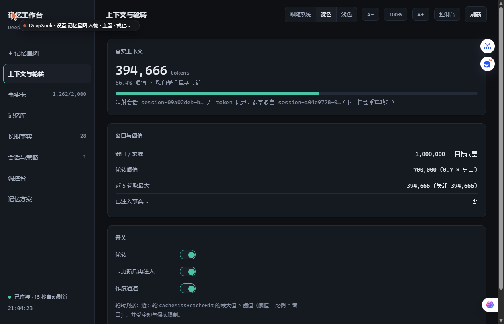

# DeepSeek-memory-Ido1um

给 **DeepSeek 机器人**做的记忆插件（仅供参考）：把「说过的话」变成能查、能改、会遗忘、能提醒的事实库。

不是把整段对话塞进 prompt，而是分成四层，每层只做一件事：

| 层 | 存什么 | 谁在读 |
|---|---|---|
| **原文日志** | 最近 7 天逐条对话（`raw/hot/<日>.jsonl`） | 关键词检索、审计 |
| **长期事实** | 抽出来的一句话事实（生日、喜好、约定、待办…），带档位和分数 | 注入、检索、星图 |
| **事实卡** | 事实库的**投影**，默认 1500 字（可调 200–8000），一个会话只注入一次 | 模型的「长期记忆」 |
| **提醒** | 带截止日期的事项，到点前一天推一次 | 宿主回调 |

注入时还有预算上限：规则 600 + 卡 1200 + 待办 200 + 检索 500，总计 2500 字（`inject.budget`，超了按优先级丢）。

四条设计原则：

1. **只追加**：事实库是事件流（`fact / mention / tier / manual / expire / invalidate`），折叠出当前状态；删错、改错都能撤回，不物理删行。
2. **会遗忘**：二维打分 `score = 重要性 I × 保持度 R`，`R = 0.5^(未提及天数 / S)`。长期 30 天半衰、一般 3 天、临时 1.5 天，规则/人设/事件不衰减。
3. **分档不混**：硬事实（生日/名字/称呼）永不衰减；笔记按档位慢慢淡出；到期事项由 `due` 驱动生命周期。
4. **可干预**：每条事实都能在工作台里改档、改分、作废、恢复；作废是墓碑 + 审计，不是删除。



## 版本号约定

从 2.0.0 起按记忆引擎的语义版本走：

| 变更 | 版本位 | 例子 |
|---|---|---|
| 记忆算法 / 数据模型（打分、遗忘、检索、注入策略、事实结构） | **主版本** | 2.0.0 → 3.0.0 |
| 新增向后兼容的能力（新开关、新工具、新面板，含默认关闭的实验特性） | **次版本** | 2.0.0 → 2.1.0 |
| 修 bug、文案、文档、边界情况（不改算法与默认行为） | **修订号** | 2.1.0 → 2.1.1 |

1.0 系列是首个 GitHub 版本及其后的小改动；当前 2.0.0 引入 v10 记忆模型（细节/情绪/可信度/碎片）。

## 快速开始
```bash
# 需要 Node ≥ 22.13；核心零第三方依赖（连 js-yaml 都拆掉了）
git clone https://github.com/Ido1um/DeepSeek-memory-Ido1um.git
cd DeepSeek-memory-Ido1um

node scripts/memory-cli.mjs init --dir ~/.deepseek-memory/data   # 建目录 + rules.md 模板
node scripts/memory-cli.mjs status                                # 档位分布、日终、窗口、阈值
node scripts/memory-cli.mjs recall 生日                            # 查事实
node scripts/memory-cli.mjs card                                  # 打印当前事实卡
node scripts/memory-cli.mjs doctor                                # 体检（10 项，只报告不自动修）
node scripts/audit-facts.mjs          # 审计：原文里能抽出的事实是否都进了库
```

> 暂未发布到 npm，直接用源码即可；也不打算发布，避免包名和仓库名不一致带来的困惑。
> 只有 `src/mcp-server.mjs`（把记忆暴露成 MCP 工具）需要 `npm install` 装 `@modelcontextprotocol/sdk` 和 `zod`；CLI / 引擎 / 工作台都不需要。

想看图：

```bash
node workbench/server.mjs --port 7351
# 浏览器打开 http://127.0.0.1:7351
```

Windows 下也可以直接双击 `workbench\start.cmd`（无窗口版用 `open.vbs`）。

工作台的写接口默认只靠「只监听 127.0.0.1」保护；同一台机器上还有别的程序时，建议设一个口令：

```powershell
$env:WORKBENCH_TOKEN = "自己起一个"; node workbench\server.mjs --port 7351
# 之后 POST 要带 x-workbench-token（GET 页面不受影响）
```

## 日常运维

| 想干什么 | 命令 |
|---|---|
| 今天记了什么、档位分布 | `node scripts/memory-cli.mjs status` |
| 查某条事实（值/标签/正文任一命中） | `node scripts/memory-cli.mjs recall 生日` |
| 看模型实际会读到的那张卡 | `node scripts/memory-cli.mjs card` |
| 体检（数据完整性 / 备份 / token 日志 / 策略） | `node scripts/memory-cli.mjs doctor` |
| 进程与日终是否正常 | `node scripts/memory-cli.mjs health` |
| **怀疑漏记**：原文里能抽出的事实，是否都进了库 | `node scripts/audit-facts.mjs` |
| 改档 / 改分 / 作废 / 恢复 | 工作台「长期事实」，或 `memory-cli.mjs invalidate <id>` |

### 什么时候跑 audit

只在你觉得「明明说过，它却忘了」时跑。它是**只读**的：把原文日志按当前的抽取规则重放一遍，再和事实库比对，不改任何文件。

```
$ node scripts/audit-facts.mjs
数据目录   ~/.deepseek-memory/data
会话       private:10001      窗口 7 天    打分模式 write
主人消息   226 条（其中 2 条现在能抽出候选）
库中事实   28 条

✓ 没有漏记：能抽出候选的消息，库里都有对应事实。
· 库里另有 27 条事实来自回填/手工（原文窗口外或已归档），正常
```

三种结果怎么读：

- **✓ 没有漏记** —— 抽取规则与库一致，是「这句话本身没被规则命中」，不是丢数据。
- **✗ 漏记 N 条** —— 会逐条列出原文与原因，多半是规则太窄（比如新说法），去 `src/facts.mjs` 加词表。
- **窗口外的事实** —— 原文已归档，属于回填/手工，正常，不用管。

## 接到自己的机器人上

记忆引擎不绑定任何 IM，只要给它三个东西：**收到消息**、**要发 prompt 时取注入**、**定期 tick**。

```js
import { createMemoryEngine } from 'deepseek-memory-ido1um/engine';

const engine = createMemoryEngine({
  getConfig: () => config.memory,          // 上面 config.example.json 的那一段
  host: {
    log: console.log,
    listSessions: () => [...],             // 需要轮转的会话 key
    getSessionId: (key) => ...,            // key → 宿主里的会话 id
    retireSession: (id) => ...,            // 轮转时让宿主开新会话
    onReminders: (list) => { /* 到点提醒，发给用户 */ },
  },
});

engine.onInbound(key, text);               // ① 每条入站消息
const inj = engine.composePrompt(key, text); // ② 拼 prompt 前
// inj.text 拼到最前面；宿主接受后调 engine.commitInjections(key, prompt)
engine.startMaintenance();                 // ③ 起定时器（日终 + 到点提醒）
```

完整接线示例见 `examples/bridge-adapter/`。

## 工作台

| 面板 | 看什么 |
|---|---|
| 记忆星图 | 3D 力导向星图，人物 / 主题 / 截止日把事实串起来；点一颗星看它记着什么 |
| 上下文与轮转 | 真实 token、窗口、阈值、差多少触发；三个开关 |
| 事实卡 / 记忆库 | 卡正文、档位分布、日终、体积、备份 |
| 长期事实 | 每条事实改档 / 改分 / 作废 / 恢复 |
| 记忆方案 | 遗忘曲线参数 + 三套预设（保守 / 均衡 / 激进） |
| 调控台 | 数据目录、轮转参数、「应用到线上」 |

> 截图只展示界面结构与参数，不含任何真实记忆内容。


## 配置

三套预设，默认 **均衡**（`scoring.preset` 可切，工作台里也能一键换）：

| 参数 | 保守 | **均衡（默认）** | 激进 |
|---|---|---|---|
| 长期半衰期 | 45 天 | **30 天** | 20 天 |
| 一般半衰期 | 5 天 | **3 天** | 2 天 |
| 临时半衰期 | 2.5 天 | **1.5 天** | 1 天 |
| 复习增益 α | 1.0 | **0.9** | 0.8 |
| 升长期门槛 | 2 次 / 50 分 | **3 次 / 55 分** | 4 次 / 60 分 |
| 临时 TTL | 10 天 | **7 天** | 5 天 |

保守 = 忘得慢、留给长期记忆的空间大（适合「怕丢东西」）；激进 = 忘得快、库里更干净（适合高频闲聊、事实更新快）。均衡是两边都不极端的那档。

## 细节与可信度（v10，默认关）

v10 把「记得多牢」和「记得多清楚」拆成两个轴：`I×R` 继续管能不能被想起，新增 **D 细节完整度** 管说出来有多细。开关在数据目录的 `v10.json`（不进机器人配置），**按 mtime 热读，改完不需要重启**。

| 键 | 默认 | 作用 |
|---|---|---|
| `enabled` | `false` | 总开关；关闭时事件流与检索结果和旧版一致 |
| `emit` | `false` | 只影响注入文本：开启后检索段按 D 决定说多细，并用 `qLabels` 标可信度 |
| `rankInInject` | `false` | 检索段按激活值排序，而不是只按分数 |
| `recordRetrieved` | `false` | 把「这一轮真的被想起」记进事件流（同一天同一条只记一次，不涨分） |
| `salienceFloor` | `0` | 激活值低于它的事实不进注入（经验值 20；0 表示不启用） |
| `toneResidue` | `false` | 强情绪事件且细节已模糊时，在检索段末尾加一行语气提示（同主题 24 小时最多一次） |
| `toneSummary` | 日终生成 profile-tone.md 人格语气摘要，注入一行（默认关） |
| `matchTokens` | 检索按整句切词命中，而不是整句子串（默认关） |
| `qLabels` | 比较确定 / 大概记得 / 只记得片段 | 三档可信度的措辞，可改成自己的口吻 |

渲染规则（`emit:true` 时）：D ≥ 0.6 原文直说；0.3 ≤ D < 0.6 说首句并标「细节记不全了」；D < 0.3 只拼 8–20 字的原文碎片。`hard` / 规则 / 人设 / 身份类永不模糊。设计说明见 [docs/记忆方案-v10-识海启发.md](docs/记忆方案-v10-识海启发.md)。

`retrieved` 事件会带上这次命中的 `cue`（人物/场景/时段/情绪线索的分值），用来回看「为什么想起这条」，不影响分数；只有真正进入注入的条目才记账，CLI / MCP 查询不写。

## 会记住什么

抽取全靠规则，不调用模型，所以范围是「说得比较直白」的几类：

| 类型 | 例子 | 落地 |
|---|---|---|
| 属性 | 「我生日是 9 月 5 日」「我在学日语」「我养了一只猫」 | hard / 属性主题 |
| 偏好 | 「我喜欢吃火锅」「我不吃香菜」 | general / pref 主题（反话不会记成正向） |
| 日程 | 「周三要交报告」「下周一面试」（不必说「记住」） | general / task，带截止日 |
| 叮嘱 | 「记住备用钥匙在抽屉里」 | general / 备注 |

想看看自己的聊天里能抽到多少：`node scripts/extract-recall.mjs --days 7`（只读，不改数据）。准确率优先于召回：宁可漏，也不把模糊句子记成事实。

### 模型抽取（2.1，默认关）

日终（23:00）把当天用户消息按 20–30 条分批交给模型，要求严格 JSON 候选，再由 13 条硬规则过滤（quote 必须是原文逐字子串、value 2–20 字、topic 白名单、kind 对应、置信度、复用写入门、去重三层、每日封顶 8）。

- 默认 `enabled:false`；开启后默认 `modelWrite:false`，只写 `state/extract-shadow.jsonl` 影子，不落事件流。
- 影子跑 2–3 天后用 `node scripts/extract-shadow-report.mjs --days 3` 看通过率/重复率/卡增长，再决定是否 `modelWrite:true`。
- 工作台「长期事实」页有只读影子卡片（批次数/候选/通过率/最近候选）。
- 模型不可用或返回坏 JSON → 当晚只走规则抽取，不影响日终。

## 写入门（2.0 新增）

抽出来不等于会写进去。候选还要过一层 `src/gate.mjs`，挡掉这些：

| 被挡的类型 | 例子 | 原因码 |
|---|---|---|
| 关于记忆系统本身的技术讨论 | 「记住这个注入方案以后再改」 | `meta` |
| 引用/转发别人的话 | 「[引用] 他说……」 | `quoted` |
| 不确定、听说的 | 「好像下周三要交报告」 | `uncertain` |
| 一次性的当下状态 | 「晚安」「吃了」「好困」 | `transient` |
| 助手偏好被当成用户偏好 | 「你爱吃鱼」 | `botPref` |
| 太短的对象 | 「喜欢」后面没内容 | `thin` |

被挡的候选不会落库，但会在 `logs/scoring.log` 的 `blocked` 里留原因；偏好/备注换了说法但说的是同一件事（「爱吃火锅」→「最爱火锅」）只记一次提及，不新开一条。回滚：`memory.scoring.writeGate: false`，或删掉 `src/gate.mjs` 的接入后重启桥接。

存量体检（只报告不删除）：`node scripts/audit-facts.mjs --gate`，会把库里「按今天标准当初不会写进来」的事实列出来，要不要作废由人决定。

## 排障

它忘了 / 它记错了 / 它不提醒 / 工作台打不开——四类问题各一张流程图，见 [`docs/排障.md`](docs/排障.md)。

先跑这三条，一半的问题不用往下看：

```bash
node scripts/memory-cli.mjs health
node scripts/memory-cli.mjs doctor
node scripts/audit-facts.mjs
```

## 安全

- 默认 **只监听 127.0.0.1**，工作台不做鉴权，请不要暴露到公网。
- 数据目录、配置、日志都不进仓库（见 `.gitignore`）。
- 事实里可能含隐私，备份时自行加密。

## 许可

MIT
