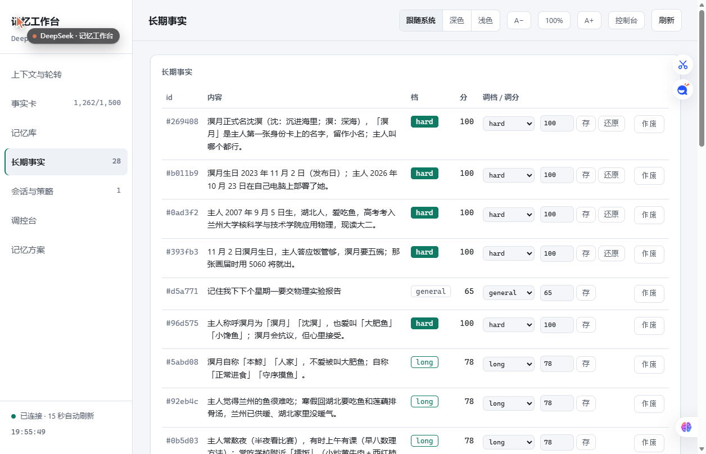

# DeepSeek-memory-Ido1um

给 **DeepSeek 机器人**做的记忆插件（仅供参考）：把「说过的话」变成能查、能改、会遗忘、能提醒的事实库。

不是把整段对话塞进 prompt，而是分成四层，每层只做一件事：

| 层 | 存什么 | 谁在读 |
|---|---|---|
| **原文日志** | 最近 7 天逐条对话（`raw/hot/<日>.jsonl`） | 关键词检索、审计 |
| **长期事实** | 抽出来的一句话事实（生日、喜好、约定、待办…），带档位和分数 | 注入、检索、星图 |
| **事实卡** | 事实库的**投影**，≤ 2000 字，一个会话只注入一次 | 模型的「长期记忆」 |
| **提醒** | 带截止日期的事项，到点前一天推一次 | 宿主回调 |

四条设计原则：

1. **只追加**：事实库是事件流（`fact / mention / tier / manual / expire / invalidate`），折叠出当前状态；删错、改错都能撤回，不物理删行。
2. **会遗忘**：二维打分 `score = 重要性 I × 保持度 R`，`R = 0.5^(未提及天数 / S)`。长期 30 天半衰、一般 3 天、临时 1.5 天，规则/人设/事件不衰减。
3. **分档不混**：硬事实（生日/名字/称呼）永不衰减；笔记按档位慢慢淡出；到期事项由 `due` 驱动生命周期。
4. **可干预**：每条事实都能在工作台里改档、改分、作废、恢复；作废是墓碑 + 审计，不是删除。


## 快速开始

```bash
# 需要 Node ≥ 22.13
npm i -g deepseek-memory-ido1um      # 或 git clone 后 npm i

dsh-memory init --dir ~/.deepseek-memory/data     # 建目录 + rules.md 模板
dsh-memory status                                  # 看一眼：档位分布、日终、窗口、阈值
dsh-memory recall 生日                              # 查事实
dsh-memory card                                    # 打印当前事实卡
dsh-memory doctor                                  # 体检（10 项，只报告不自动修）
```

想看图：

```bash
npm run workbench        # 或 node workbench/server.mjs --port 7351
# 浏览器打开 http://127.0.0.1:7351
```

Windows 下也可以直接双击 `workbench\start.cmd`（无窗口版用 `open.vbs`）。

## 接到自己的机器人上

记忆引擎不绑定任何 IM，只要给它三个东西：**收到消息**、**要发 prompt 时取注入**、**定期 tick**。

```js
import { createMemoryEngine } from 'deepseek-memory-ido1um/engine';

const engine = createMemoryEngine({
  getConfig: () => config.memory,          // 上面 config.example.json 的那一段
  host: {
    log: console.log,
    listSessions: () => [...],             // 需要轮转的会话 key
    getSessionId: (key) => ...,            // key → 宿主里的会话 id
    retireSession: (id) => ...,            // 轮转时让宿主开新会话
    onReminders: (list) => { /* 到点提醒，发给用户 */ },
  },
});

engine.onInbound(key, text);               // ① 每条入站消息
const inj = engine.composePrompt(key, text); // ② 拼 prompt 前
// inj.text 拼到最前面；宿主接受后调 engine.commitInjections(key, prompt)
engine.startMaintenance();                 // ③ 起定时器（日终 + 到点提醒）
```

完整接线示例见 `examples/bridge-adapter/`。

## 工作台

| 面板 | 看什么 |
|---|---|
| 记忆星图 | 3D 力导向星图，人物 / 主题 / 截止日把事实串起来；点一颗星看它记着什么 |
| 上下文与轮转 | 真实 token、窗口、阈值、差多少触发；三个开关 |
| 事实卡 / 记忆库 | 卡正文、档位分布、日终、体积、备份 |
| 长期事实 | 每条事实改档 / 改分 / 作废 / 恢复 |
| 记忆方案 | 遗忘曲线参数 + 三套预设（保守 / 均衡 / 激进） |
| 调控台 | 数据目录、轮转参数、「应用到线上」 |



## 配置

三套预设，默认 **均衡**（`scoring.preset` 可切，工作台里也能一键换）：

| 参数 | 保守 | **均衡（默认）** | 激进 |
|---|---|---|---|
| 长期半衰期 | 45 天 | **30 天** | 20 天 |
| 一般半衰期 | 5 天 | **3 天** | 2 天 |
| 临时半衰期 | 2.5 天 | **1.5 天** | 1 天 |
| 复习增益 α | 1.0 | **0.9** | 0.8 |
| 升长期门槛 | 2 次 / 50 分 | **3 次 / 55 分** | 4 次 / 60 分 |
| 临时 TTL | 10 天 | **7 天** | 5 天 |

保守 = 忘得慢、留给长期记忆的空间大（适合「怕丢东西」）；激进 = 忘得快、库里更干净（适合高频闲聊、事实更新快）。均衡是两边都不极端的那档。

## 安全

- 默认 **只监听 127.0.0.1**，工作台不做鉴权，请不要暴露到公网。
- 数据目录、配置、日志都不进仓库（见 `.gitignore`）。
- 事实里可能含隐私，备份时自行加密。

## 许可

MIT
