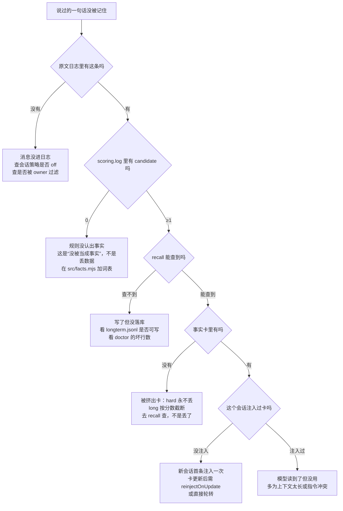
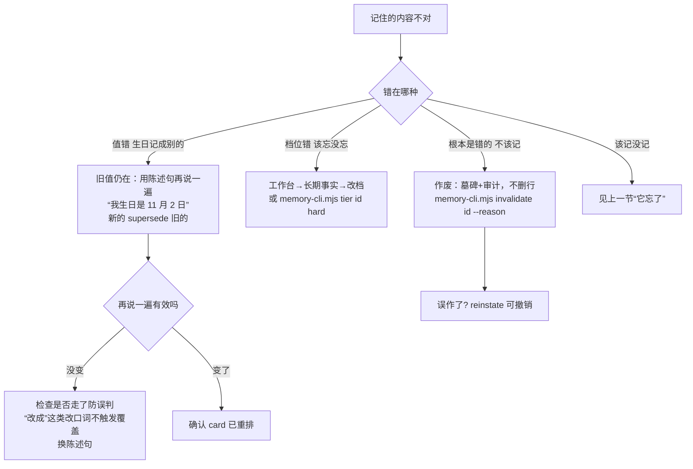
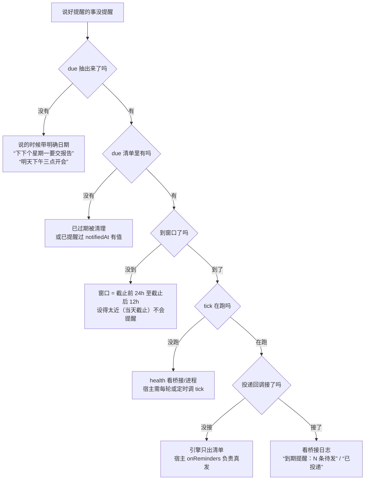
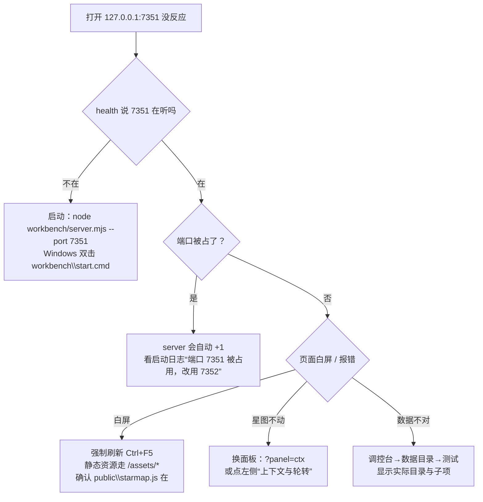

# 排障

四类问题，四张图。**先跑这三条，把输出贴出来**，一半的问题不用往下看：

```bash
node scripts/memory-cli.mjs health     # 进程 / 日终 / 记忆开关
node scripts/memory-cli.mjs doctor     # 数据完整性 / 备份 / token 日志 / 策略
node scripts/audit-facts.mjs           # 原文里能抽出的事实，是否都进了库
```

| 症状 | 先怀疑哪一层 | 第一条命令 |
|---|---|---|
| 它忘了 | 抽取规则 → 注入 | `audit-facts.mjs` |
| 它记错了 | 事实值 / 档位 / 规则 | `recall <关键词>` |
| 它不提醒 | due 抽取 → 提醒窗口 → 投递 | `memory-cli.mjs due` |
| 工作台打不开 | 端口 / 数据目录 | `memory-cli.mjs health` |

---

## 1. 它忘了：说过的没记住



**逐条怎么看**

```bash
# ① 原文里有没有
node scripts/memory-cli.mjs search 物理实验

# ② 抽取器认出没有（每条消息一行，cand 是候选数）
tail -n 20 <数据目录>/logs/scoring.log

# ③ 库里有没有
node scripts/memory-cli.mjs recall 物理

# ④ 卡里有没有
node scripts/memory-cli.mjs card
```

- `cand:0` 是**最常见**的情况：这句话不在规则词表里（比如新的说法、纯情绪、指代不明），系统判断为「不值得记」，这是设计而不是故障。
- 卡（≤ 2000 字）是投影，不是全量库。卡里没有 **不代表丢了**，`recall` 才是真值。
- 卡更新后长会话不会立刻看到：默认 `reinjectOnUpdate` 开启，但要求会话龄 ≥ 3 天且卡确实变了；否则等下一次轮转。

---

## 2. 它记错了



**几条容易踩的**

- **改口要用陈述句**：「我生日是 11 月 2 日」。写成「我生日改成 11 月 2 日」时，抽取器会把它当闲聊（防误判规则），不会覆盖旧值。
- **作废是墓碑，不是删除**：`invalidate` 后检索/卡/摘要都不再返回，但原文和审计留痕；`reinstate` 随时可恢复。
- **作废会连坐**：同一主题的版本链（supersede 的后代）会一起作废，避免旧版本复活。
- **规则和人设类只被覆盖，不衰减**：如果它反复用错的称呼，先看 `<数据目录>/rules.md`——手写的规则优先级最高。

```bash
node scripts/memory-cli.mjs recall 生日          # 看现在是什么值、什么档
node scripts/memory-cli.mjs describe h-20261029-0ad3f2   # 单条：档位/分数/重要度/保持度
node scripts/memory-cli.mjs invalidate h-… --reason "记错了"
node scripts/memory-cli.mjs reinstate h-…
```

---

## 3. 它不提醒



```bash
node scripts/memory-cli.mjs due      # 带截止日期的事项（含“已提醒/未提醒”）
```

**三个边界**

1. **没有截止日期就没有提醒**：「记得提醒我」不带时间，只能当备注，不会进 due 清单。
2. **当天截止不提醒**：窗口是「截止前 24 小时」开始；今天说今天交，窗口已经错过（或者只剩几小时）。
3. **提醒只发一次**：投递成功会写 `notified` 事件，不会重复打扰；要再提醒就补一句带日期的话。

---

## 4. 工作台打不开



**几条经验**

- 工作台**只是只读看板 + 改配置**，它挂了不影响记忆和聊天；别为了看图去重启桥接。
- 端口占用会自动切下一个，**以启动日志为准**，不要死认 7351。
- 打开默认落在「记忆星图」；星图是纯投影，数据来自 `buildGraph`，图里没有某条事实就去「长期事实」面板找。
- 「应用到线上」会备份桥接配置再改 `memory` 段，改完要重启桥接才生效。

---

## 附：把这三条贴给我

```
node scripts/memory-cli.mjs health
node scripts/memory-cli.mjs doctor
node scripts/audit-facts.mjs
```

`health` 回答「服务活着吗」，`doctor` 回答「数据坏了吗」，`audit` 回答「该记的记了吗」。三条都是只读，不会改任何文件。
